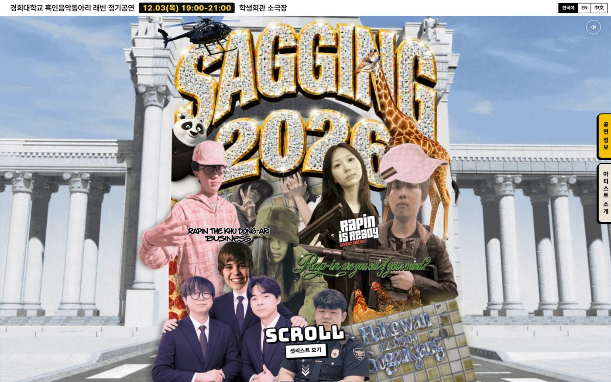
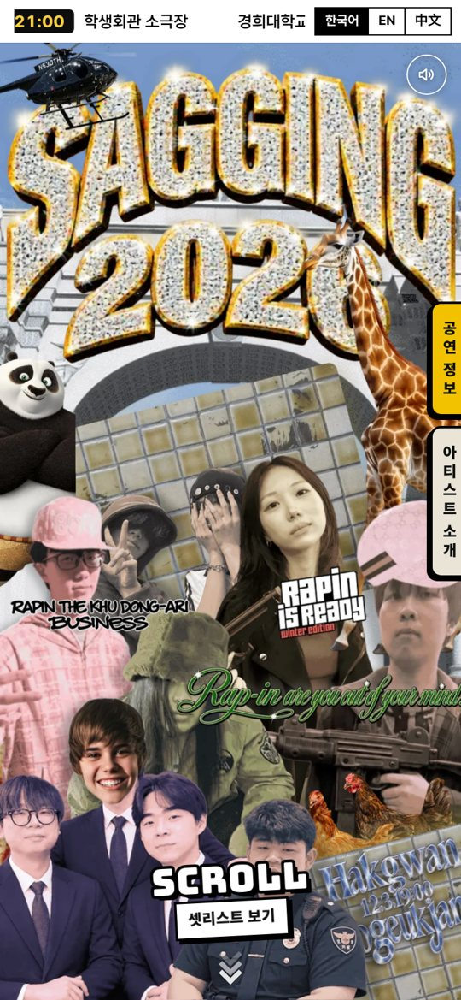
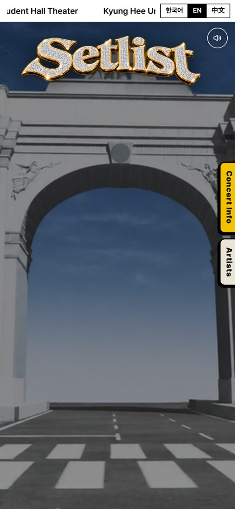
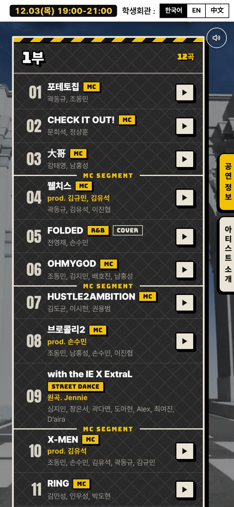
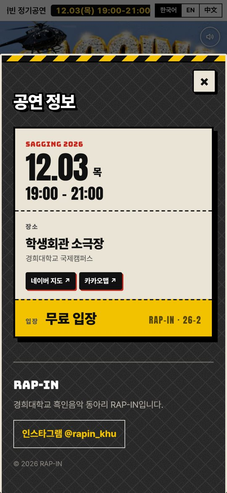
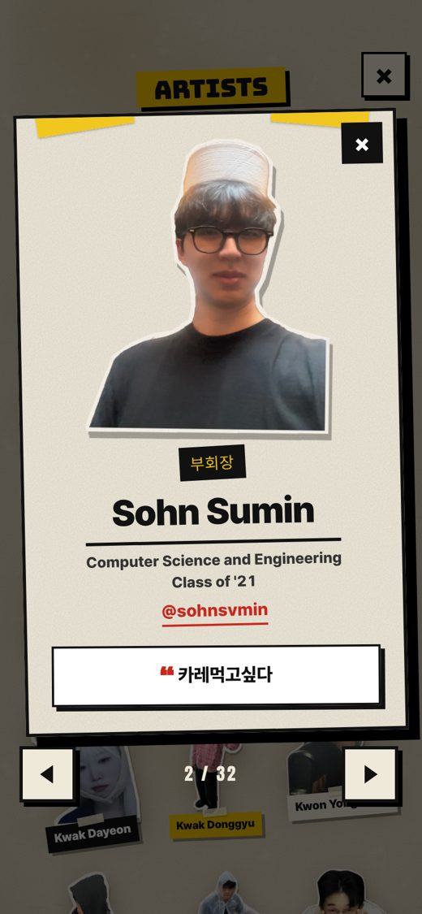
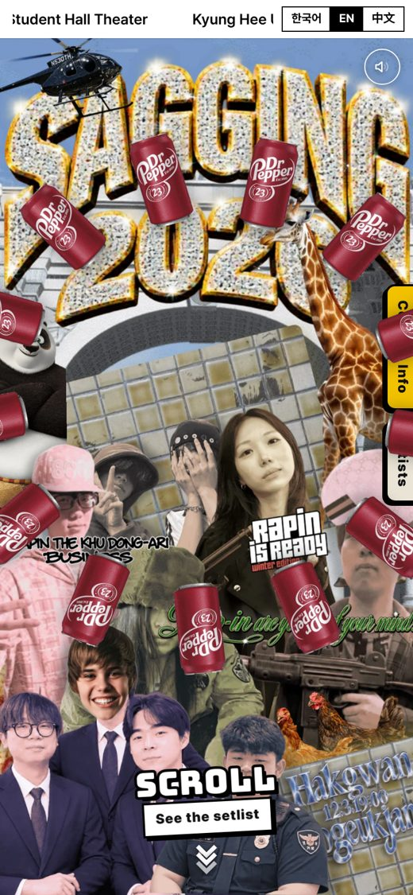
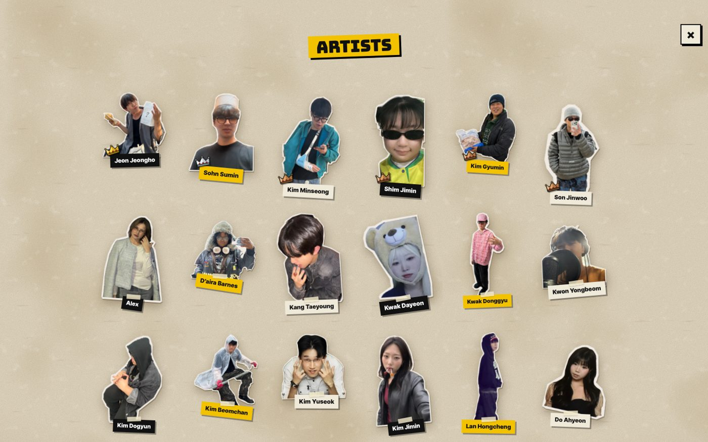

<p align="center">
  
</p>

<h1 align="center">SAGGING 2026</h1>

<p align="center">
  경희대학교 흑인음악 동아리 <b>RAP-IN</b> 26-2 정기공연 관객용 페이지<br>
  2026. 12. 3 (목) 19:00–21:00 · 국제캠퍼스 학생회관 소극장 · 무료 입장
</p>

<p align="center">
  <a href="https://khu-rapin-26-2.vercel.app/"><b>khu-rapin-26-2.vercel.app</b></a>
  &nbsp;·&nbsp;
  <a href="https://www.instagram.com/rapin_khu/">Instagram @rapin_khu</a>
</p>

<br>

인쇄용 포스터를 레이어별로 잘라 웹에서 다시 조립한 페이지입니다. 스크롤하면 포스터 속 인물과 소품이 화면 밖으로 흩어지고, 그 자리에 셋리스트가 올라옵니다. 공연 정보와 아티스트 소개는 화면 오른쪽 탭으로 엽니다.

빌드 도구 없이 HTML, CSS, 바닐라 JS(ES 모듈)로만 만들었습니다.

## 화면

<table>
  <tr>
    <td align="center" width="33%"></td>
    <td align="center" width="33%"></td>
    <td align="center" width="33%"></td>
  </tr>
  <tr>
    <td align="center"><sub>모션 포스터</sub></td>
    <td align="center"><sub>스크롤하면 레이어가 빠져나갑니다</sub></td>
    <td align="center"><sub>셋리스트 (공개 전엔 카운트다운)</sub></td>
  </tr>
  <tr>
    <td align="center"></td>
    <td align="center"></td>
    <td align="center"></td>
  </tr>
  <tr>
    <td align="center"><sub>공연 정보</sub></td>
    <td align="center"><sub>아티스트 카드</sub></td>
    <td align="center"><sub>이스터 에그</sub></td>
  </tr>
</table>

<p align="center">
  <br>
  <sub>아티스트 소개 콜라주 (PC)</sub>
</p>

## 구현한 것

**모션 포스터**
- 피그마 포스터에서 뽑은 레이어 23장을 `assets/js/motion/poster-layers.js`에 좌표(포스터 기준 박스)로 적어 두고, 화면 크기에 맞춰 배치합니다.
- 모바일은 원래 포스터 구도를 그대로 쓰고, PC는 A4 인쇄 레이아웃에 맞춘 `pc` 좌표를 따로 덮어씁니다.
- 레이어마다 천천히 흔들리는 움직임이 있고, 스크롤 구간은 GSAP ScrollTrigger로 고정(pin)해서 레이어가 하나씩 화면 밖으로 빠져나갑니다.
- 배경음악을 켜면 킥 드럼에 맞춰 SAGGING 2026 로고가 살짝 커졌다 돌아옵니다. 실시간 오디오 분석은 아이폰에서 음악이 끊기기 때문에, `bgm.mp3`의 킥 위치를 미리 뽑아 둔 `data/bgm-kicks.json`을 재생 시간에 맞춰 읽습니다.

**셋리스트**
- `data/setlist.json`의 `revealAt`(11/27 22:00) 전에는 카운트다운만 보이고, 시간이 지나면 1·2·3부 순서표가 열립니다.

**공연 정보 / 아티스트 소개**
- 화면 오른쪽 탭으로 여는 창입니다. 주소 끝에 `#info`, `#artists`를 붙이면 바로 열립니다.
- 아티스트 32명은 사진을 누끼 따서 종이 오린 테두리를 둘러 콜라주로 붙였습니다.
- 임원진은 왕관(회장 금, 부회장 은, 부장 동)과 함께 맨 앞에 오고, 나머지는 이름순(영문 이름 먼저, 그다음 가나다)으로 정렬합니다. 언어를 바꿔도 순서는 같습니다.
- 사진을 누르면 카드가 열립니다. 화살표 키, ◀ ▶ 버튼, 스와이프로 넘길 수 있습니다.
- 공개 페이지라 학번 전체, 나이, 국적은 싣지 않고 학과와 입학 연도만 표시합니다.

**다국어**
- 한국어 / English / 中文. 문구는 `data/i18n/{ko,en,zh}.json`에 있고, HTML에는 `data-i18n="키"`만 답니다. 학과명 영문 표기는 경희대 공식 표기를 따릅니다.

**이스터 에그**
- 포스터의 lil donggyu를 세 번 누르면 배경음악이 바뀌고 닥터페퍼 캔이 화면을 둘러싸고 돕니다. 누를 때마다 말풍선으로 몇 번 남았는지 알려 줍니다.
- 레이어가 겹쳐 있어서, 누른 좌표가 실제로 그 이미지의 불투명한 픽셀 위인지 캔버스로 확인합니다.

**그 밖에**
- `prefers-reduced-motion`을 켠 기기에서는 애니메이션 없이 정적인 화면을 보여 줍니다.
- 이미지와 스크립트 주소 끝의 `?v=` 값으로 캐시를 갱신하므로, 수정한 내용이 바로 반영됩니다.
- 방문자 정보는 수집하지 않습니다. 입력 폼, 로그인, 분석 도구, 광고 쿠키가 없으며 언어·소리 설정만 브라우저에 저장합니다.

## 폴더 구조

```
rapin-26-2/
├─ index.html                 페이지 뼈대
├─ 404.html
├─ assets/
│  ├─ css/
│  │  ├─ base.css             글꼴, 색 변수, 리셋
│  │  ├─ layout.css           상단 바, 섹션
│  │  ├─ poster.css           모션 포스터
│  │  ├─ panels.css           공연 정보 / 아티스트 창, 콜라주, 카드
│  │  └─ program.css          셋리스트, 푸터, 이스터 에그
│  ├─ js/
│  │  ├─ main.js              진입점
│  │  ├─ data.js              JSON 불러오기
│  │  ├─ i18n.js              언어 전환
│  │  ├─ bgm.js               배경음악, 이스터 에그
│  │  ├─ sections/            info.js, artists.js, panels.js, program.js
│  │  └─ motion/              poster.js, poster-layers.js, beat.js
│  ├─ img/                    poster/ (레이어), artists/ (누끼 사진), og/ (공유 미리보기)
│  ├─ audio/                  배경음악
│  ├─ fonts/                  Pretendard, Bungee, Anton
│  └─ vendor/                 GSAP, ScrollTrigger (CDN 없이 포함)
├─ data/
│  ├─ concert.json            날짜, 장소, 지도 링크
│  ├─ setlist.json            셋리스트, 공개 시각
│  ├─ artists.json            아티스트 이름, 학과, 인스타, 한 줄 소개
│  ├─ bgm-kicks.json          배경음악 킥 위치
│  └─ i18n/                   ko.json, en.json, zh.json
└─ docs/
   ├─ REQUIREMENTS.md
   └─ readme/                 이 문서의 스크린샷
```

## 내용 바꾸기

| 바꿀 것 | 파일 |
|---|---|
| 날짜, 장소, 링크 | `data/concert.json` |
| 셋리스트, 공개 시각 | `data/setlist.json` |
| 아티스트 | `data/artists.json` + `assets/img/artists/{id}.webp` |
| 화면 문구 | `data/i18n/*.json` |
| 포스터 레이어 위치 | `assets/js/motion/poster-layers.js` |

이미지나 JS를 바꾼 뒤에는 해당 주소의 `?v=` 값을 올려야 방문자 브라우저에 새 파일이 적용됩니다.

## 로컬에서 보기

JSON을 `fetch`로 불러오기 때문에 파일을 더블클릭해서 열면 동작하지 않으며, 간단한 서버로 열어야 합니다.

```bash
python -m http.server 8000
# http://localhost:8000
```

## 배포

`main` 브랜치에 푸시하면 Vercel이 자동으로 배포합니다. 빌드 단계 없이 저장소 파일을 그대로 올립니다.

## 만든 사람

- 개발 [@sohnsvmin](https://www.instagram.com/sohnsvmin/)
- 디자인 [@dongmen8lildongu](https://www.instagram.com/dongmen8lildongu/)

아티스트 정보 수정이나 삭제 요청은 [@rapin_khu](https://www.instagram.com/rapin_khu/)로 보내 주십시오.

## 라이선스

- Pretendard, Bungee, Anton: SIL Open Font License 1.1 (`assets/fonts/`)
- GSAP: GreenSock Standard License (`assets/vendor/README.md`)
- 포스터 이미지, 아티스트 사진, 음원의 권리는 RAP-IN과 각 아티스트에게 있습니다.
